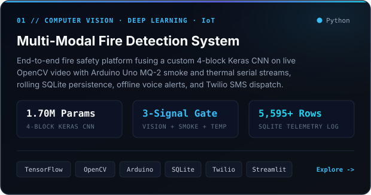
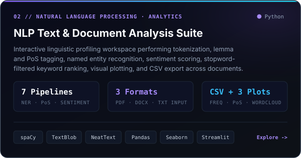

<!-- ===================================================================== -->
<!--  SUBHADEEP MAITY — GITHUB PROFILE README                              -->
<!--  Repository: https://github.com/Subha-boop/Subha-boop                 -->
<!--  Before publishing: replace YOUR-LINKEDIN-HANDLE and                  -->
<!--  your.email@example.com with your actual LinkedIn & email address.    -->
<!-- ===================================================================== -->

<div align="center">
  
</div>

<br />

<div align="center">
  <!-- TODO: Replace YOUR-LINKEDIN-HANDLE and your.email@example.com before pushing -->
  <a href="https://github.com/Subha-boop">
    
  </a>&nbsp;
  <a href="https://www.linkedin.com/in/subhadeep-maity-068810329/">
    
  </a>&nbsp;
  <a href="mailto:subhadeepmaity45@gmail.com">
    
  </a>
  <!-- Optional: uncomment and add verified links when ready
  <a href="https://YOUR-PORTFOLIO-URL">
    
  </a>
  -->
</div>

<p align="center">
  
</p>

## About Me

I'm **Subhadeep Maity** — a **3rd-year (5th semester) B.Tech Computer Science & Engineering** undergraduate specializing in **Artificial Intelligence and Machine Learning**, working at the intersection of applied machine learning, generative AI, and backend software engineering.

My work focuses on turning models into complete, usable software systems rather than isolated notebooks — from pairing a custom convolutional neural network with live serial hardware sensors and persistent telemetry storage, to building multi-format natural language analysis workflows. I care about mathematical clarity inside the model and clean architecture, data flow, and reliability around it.

- **Academic Track:** B.Tech in Computer Science & Engineering (AI & ML) — 3rd Year, 5th Semester
- **Core Interests:** `Machine Learning` · `Deep Learning` · `LLMs & Generative AI` · `AI Agents` · `Computer Vision` · `NLP` · `Backend Engineering`
- **Currently Learning:** Transformer architectures, retrieval-augmented generation (RAG), agentic workflows, PyTorch, FastAPI, PostgreSQL, and backend system design
- **Currently Building:** End-to-end AI/ML applications and API-driven backend services that take trained models and LLM pipelines cleanly into production

```text
Engineering Trajectory:  Data & Math  ──▶  ML / DL Models  ──▶  LLMs & Agents  ──▶  Backend APIs & Systems
```

### Engineering Snapshot

| Metric | Context (Verified Across Public Repositories) |
| :--- | :--- |
| **`1.70M` parameters** | Custom 4-block TensorFlow/Keras CNN (`150×150×3` RGB input) trained for real-time visual flame detection |
| **`3-signal` fusion gate** | Joint vision (`P(fire) > 0.30`), MQ-2 smoke (`≥ 250 ppm`), and thermal threshold with 3-frame confirmation |
| **`5,595+` sensor rows** | Live `9600`-baud Arduino Uno serial readings processed through a rolling SQLite telemetry store |
| **`7` NLP diagnostics** | Token/lemma analysis, PoS tagging, NER, lexical stats, keyword ranking, sentiment scoring, and visual plots |
| **`3` document formats** | Automated `.pdf`, `.docx`, and `.txt` ingestion alongside raw text input and timestamped CSV export |

<p align="center">
  
</p>

## Tech Stack

<p align="left">
  <a href="https://github.com/Subha-boop?tab=repositories">
    
  </a>
</p>

> Technologies used directly in shipped repositories are listed under **Hands-On**; technologies currently being studied and built with during Semester 5 are explicitly marked under **Currently Learning**.

| Category | Hands-On (Used in Projects) | Currently Learning & Exploring |
| :--- | :--- | :--- |
| **Programming Languages** | `Python` · `SQL` | `C / C++` · `JavaScript / TypeScript` |
| **AI & Machine Learning** | `spaCy` · `TextBlob` · `NeatText` · `NumPy` · `Pandas` · `Matplotlib` · `Seaborn` · `WordCloud` | `Scikit-learn` · `Feature Engineering` · `Model Evaluation` |
| **Deep Learning & Vision** | `TensorFlow` · `Keras` · `CNNs` · `OpenCV` | `PyTorch` · `Transfer Learning` · `Object Detection` |
| **Generative AI & LLMs** | `NLP Tokenization, NER & Linguistic Pipelines` | `Transformers` · `LLM APIs` · `RAG Pipelines` · `AI Agents` · `LangChain / LangGraph` · `Vector Embeddings` |
| **Backend Development** | `Streamlit` · `Twilio REST API` · `PySerial (Serial I/O)` · `PyPDF2` · `docx2txt` · `pyttsx3` | `FastAPI` · `REST API Architecture` · `Pydantic` · `Async Python` · `Authentication` |
| **Databases** | `SQLite` · `MySQL` | `PostgreSQL` · `Vector Databases (FAISS / pgvector)` |
| **Cloud & DevOps** | `Git-Based Workflows` · `Environment Dependency Management` | `Docker` · `Linux Server Fundamentals` · `GitHub Actions CI/CD` |
| **Developer Tools & IoT** | `Git` · `GitHub` · `VS Code` · `Arduino Uno` · `MQ-2 & Thermal Sensors` | `Postman` · `JupyterLab` · `pytest` |

<p align="center">
  
</p>

## Featured Projects

<table>
  <tr>
    <td width="50%" valign="top">
      <a href="https://github.com/Subha-boop/Fire_Detection_Project">
        
      </a>
      <br /><br />
      <b><a href="https://github.com/Subha-boop/Fire_Detection_Project">Multi-Modal Fire Detection System</a></b><br />
      <sub><b>Problem:</b> Single-sensor smoke alarms react late in open spaces, while vision-only detectors suffer false triggers from glare and warm lighting.</sub><br />
      <sub><b>Solution:</b> Fuses real-time webcam CNN inference with Arduino Uno MQ-2 smoke and temperature readings behind a 3-frame confirmation gate before logging incidents and dispatching voice + SMS alerts.</sub><br />
      <sub><b>Architecture:</b> OpenCV RGB stream → 4-block Keras Sequential CNN (<code>1.70M</code> params, sigmoid head) + <code>9600</code>-baud PySerial telemetry → multi-signal decision gate → rolling SQLite store + <code>pyttsx3</code> voice alarm + Twilio SMS + Streamlit dashboard.</sub><br /><br />
      <a href="https://github.com/Subha-boop/Fire_Detection_Project">
        
      </a>
    </td>
    <td width="50%" valign="top">
      <a href="https://github.com/Subha-boop/nlp-text-analysis-app">
        
      </a>
      <br /><br />
      <b><a href="https://github.com/Subha-boop/nlp-text-analysis-app">NLP Text &amp; Document Analysis Suite</a></b><br />
      <sub><b>Problem:</b> Inspecting unstructured text across heterogeneous office files (<code>.pdf</code>, <code>.docx</code>, <code>.txt</code>) typically requires stitching together separate parsing, tagging, and plotting scripts.</sub><br />
      <sub><b>Solution:</b> Unifies multi-format document extraction and interactive NLP diagnostics in a single browser workspace with visual charts and downloadable token-level datasets.</sub><br />
      <sub><b>Architecture:</b> Dual ingestion layer (live text + <code>PyPDF2</code> / <code>docx2txt</code> / UTF-8 readers) → <code>spaCy</code> (<code>en_core_web_sm</code>), <code>NeatText</code>, and <code>TextBlob</code> processors → PoS/keyword/WordCloud plots (<code>Matplotlib</code>, <code>Seaborn</code>) + Base64 CSV export in Streamlit.</sub><br /><br />
      <a href="https://github.com/Subha-boop/nlp-text-analysis-app">
        
      </a>
    </td>
  </tr>
</table>

<!--
  EXPANSION TEMPLATE (Slots 3–6):
  As you publish new Generative AI, LLM Agent, and FastAPI Backend repositories,
  add another <tr> row above with two matching cards so this grid scales cleanly to 4–6 projects.
-->

<p align="center">
  
</p>

## Currently Learning

| Focus Area | Active Study & Engineering Practice |
| :--- | :--- |
| **Generative AI & LLMs** | Transformer self-attention mechanics, tokenization, structured generation, evaluation baselines, and latency/cost trade-offs |
| **AI Agents & RAG** | Grounded document retrieval, chunking strategies, vector search, tool-calling loops, and deterministic guardrails |
| **Deep Learning Systems** | Transitioning from foundational Keras CNNs to PyTorch workflows, transfer learning, data augmentation, and error analysis |
| **Backend Engineering** | Building clean REST APIs with FastAPI, Pydantic contracts, async I/O, environment-isolated secrets, and automated testing |
| **System Design** | Relational modeling with PostgreSQL, API boundaries, caching patterns, containerization with Docker, and fault handling |

<p align="center">
  
</p>

## Academic & Engineering Milestones

- **B.Tech in Computer Science & Engineering (AI & ML)** — Currently in 3rd Year, 5th Semester, focusing on machine learning, deep neural networks, natural language processing, and software engineering fundamentals.
- **Applied Computer Vision + IoT Integration** — Designed and built a multi-modal fire detection prototype integrating a 4-layer convolutional neural network with live Arduino Uno gas/thermal sensor streams, SQLite persistence, and multi-channel alerting.
- **End-to-End NLP Application Development** — Built a document-aware text analytics tool combining linguistic annotation (`spaCy`), lexical profiling (`NeatText`), sentiment analysis (`TextBlob`), statistical visualization, and structured CSV export.

<!--
  VERIFIED CERTIFICATIONS & ACHIEVEMENTS (Uncomment and add verified items only):
  - **[Certification Name]** — Issuing Organization (Year) · [Verify Credential](https://credential-url)
  - **[Hackathon / Academic Honor]** — Event / Institution (Year)
-->

<p align="center">
  
</p>

## GitHub Analytics

<p align="left">
  <a href="https://github.com/Subha-boop?tab=repositories">
    
  </a>
  <a href="https://github.com/Subha-boop?tab=followers">
    
  </a>
  <a href="https://github.com/Subha-boop?tab=repositories">
    
  </a>
  
</p>

<!-- Profile Summary Card -->
<div align="center">
  <picture>
    <source media="(prefers-color-scheme: dark)" srcset="https://github-profile-summary-cards.vercel.app/api/cards/profile-details?username=Subha-boop&theme=github_dark" />
    
  </picture>
</div>

<!-- Statistics, Languages & Contribution Streak -->
<div align="center">
  <picture>
    <source media="(prefers-color-scheme: dark)" srcset="https://github-profile-summary-cards.vercel.app/api/cards/stats?username=Subha-boop&theme=github_dark" />
    
  </picture>
  <picture>
    <source media="(prefers-color-scheme: dark)" srcset="https://github-profile-summary-cards.vercel.app/api/cards/repos-per-language?username=Subha-boop&theme=github_dark" />
    
  </picture>
</div>

<div align="center">
  <picture>
    <source media="(prefers-color-scheme: dark)" srcset="https://streak-stats.demolab.com?user=Subha-boop&theme=github-dark-blue&hide_border=true&background=0D1117&ring=38BDF8&fire=8B5CF6&currStreakLabel=22D3EE&sideLabels=94A3B8&dates=64748B" />
    
  </picture>
</div>

<!-- Contribution Activity Graph -->
<div align="center">
  <picture>
    <source media="(prefers-color-scheme: dark)" srcset="https://github-readme-activity-graph.vercel.app/graph?username=Subha-boop&bg_color=0d1117&color=94a3b8&line=38bdf8&point=8b5cf6&area=true&area_color=38bdf8&hide_border=true&custom_title=Contribution%20Activity&height=270" />
    
  </picture>
</div>

<p align="center">
  
</p>

## Connect With Me

Open to **AI/ML & Backend Engineering internships**, research projects, hackathons, and technical collaborations around deep learning, LLM systems, and backend software.

<p align="left">
  <!-- TODO: Replace YOUR-LINKEDIN-HANDLE and your.email@example.com before pushing -->
  <a href="https://www.linkedin.com/in/YOUR-LINKEDIN-HANDLE">
    
  </a>&nbsp;
  <a href="https://github.com/Subha-boop">
    
  </a>&nbsp;
  <a href="mailto:your.email@example.com">
    
  </a>
  <!-- Optional: uncomment verified profiles as needed
  <a href="https://x.com/YOUR-X-HANDLE">
    
  </a>
  <a href="https://www.kaggle.com/YOUR-KAGGLE-HANDLE">
    
  </a>
  <a href="https://leetcode.com/u/YOUR-LEETCODE-HANDLE/">
    
  </a>
  -->
</p>

<br />

<div align="center">
  
</div>
